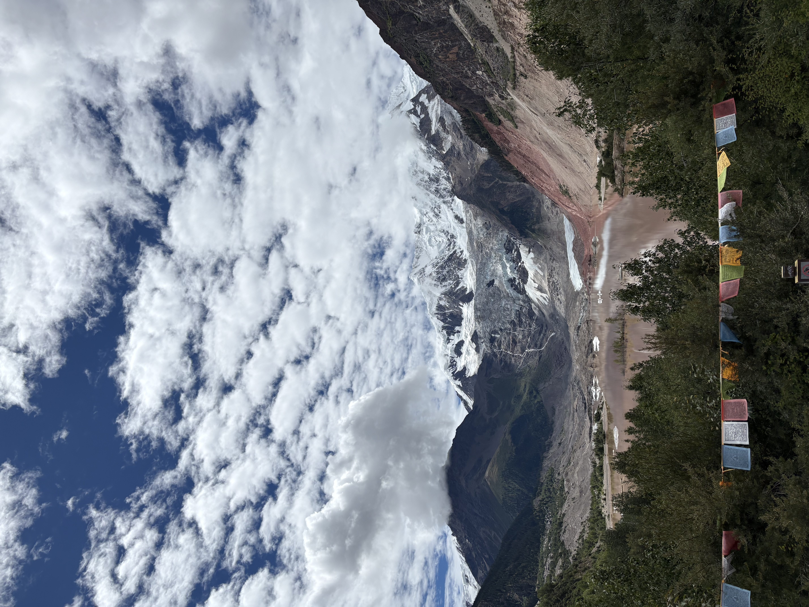

The **Multi-Hazard Intelligence Lab (MHIL)** at **King’s College London** studies how artificial intelligence can support hazard forecasting, early warning, and disaster response.

::: {.columns .about-columns}
::: {.column width="60%"}

## Research focus

Our current research centres on **landslides and cascading hazards**: detecting and mapping events from satellite data, forecasting displacement and failure, and modelling runout and spatial impact. These projects provide the foundation for a broader research agenda in **multi-hazard forecasting and decision support**.

We are interested in how hazards interact, how uncertainty can be represented in predictions, and how those predictions can inform decisions before and after an event. See our [research projects](research.qmd) for the specific questions, methods, and applications we are working on.

## Our approach

We combine **machine learning, Earth observation, and physical–statistical modelling**. Current projects use SAR and multispectral imagery, monitoring time series, and terrain data to investigate hazard detection, forecasting, and cascading processes.

Our wider research agenda includes uncertainty-aware evaluation, early warning systems, and the connection between model outputs and disaster response decisions.

:::
::: {.column width="40%"}

```{=html}
<figure class="field-photo about-photo">
  
  <figcaption>Midui Glacier, Tibet.</figcaption>
</figure>
```

:::
:::

## At King’s College London

MHIL brings together research interests in artificial intelligence, Earth systems, and disaster risk, spanning the **King’s Institute for Artificial Intelligence** and the **Department of Geography**.

The lab is led by **Lorenzo Nava**, an **AI+ Academic Senior Fellow** at King’s College London. Meet Lorenzo, the co-supervised researchers, and collaborators on the [People page](people.qmd).

## Work with us

We welcome enquiries about research collaboration, student projects, and fellowship applications aligned with these themes. Visit [Join Us](join-us.qmd) or email [lorenzo.nava@kcl.ac.uk](mailto:lorenzo.nava@kcl.ac.uk).
