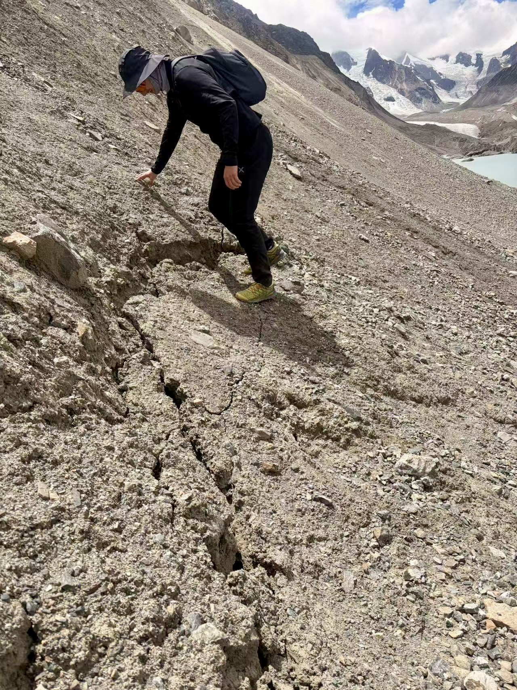
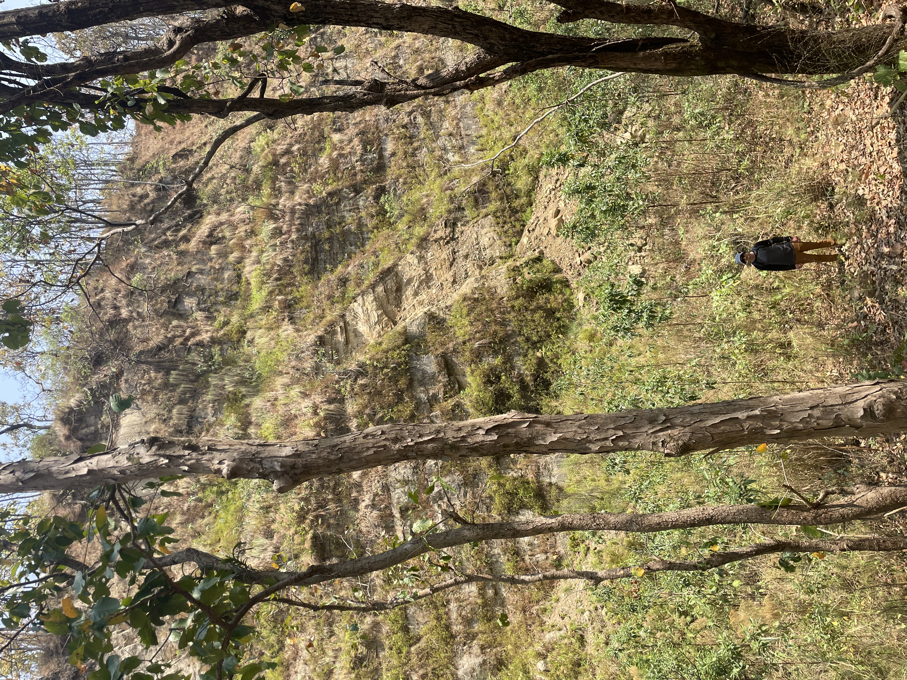

```{=html}
<h2>Core Research Themes</h2>


<div class="project-cards">

  <!-- Project 1 -->
  <div class="project-card">
    <div class="project-image">
      
    </div>

    <div class="project-title">
      Improving Landslide Disaster Response using AI, SAR, and Multispectral Data
    </div>

    <div class="project-text">
      Development of AI-driven frameworks to support rapid disaster response,
      combining SAR and multispectral satellite data for landslide detection,
      mapping, and situational awareness.
    </div>

    <div class="project-tags">
      <span>AI</span>
      <span>SAR</span>
      <span>Remote Sensing</span>
      <span>Disaster Response</span>
    </div>
  </div>

  <!-- Project 2 -->
  <div class="project-card">
  <div class="project-image">
    
  </div>

    <div class="project-title">
      Neural Networks for Predicting Cascading Hazard Runouts
    </div>

    <div class="project-text">
      Neural network models to predict runout distances and spatial impact
      of cascading hazards, including landslide–debris flow and
      multi-process gravitational mass movements.
    </div>

    <div class="project-tags">
      <span>Neural Networks</span>
      <span>Cascading Hazards</span>
      <span>Runout Modelling</span>
      <span>Multihazard</span>
    </div>
  </div>

  <!-- Project 3 -->
  <div class="project-card">
    <div class="project-image">
      
    </div>

    <div class="project-title">
      Forecasting Landslide Displacement and Failure
    </div>

    <div class="project-text">
      Data-driven modelling of landslide displacement and time of failure using
      machine learning and hybrid physical–statistical approaches.
    </div>

    <div class="project-tags">
      <span>Time Series</span>
      <span>Forecasting</span>
      <span>Landslides</span>
      <span>Uncertainty</span>
    </div>
  </div>
</div>

<h2>Co-supervised Student Projects</h2>

<div class="project-cards">

<!-- Project 4 -->
<div class="project-card">
  <div class="project-image placeholder">
    <!-- image goes here -->
  </div>

  <div class="project-title">
    Neural Networks to Classify Ground-Motion Processes at Scale
  </div>

  <div class="project-text">
    Neural network models to classify ground-motion processes from InSAR
    time series (e.g., subsidence, landslides), supporting
    rapid interpretation, and downstream hazard assessment.
  </div>

  <div class="project-meta">
    Student: <strong>Yingbo Dong</strong>,
    <em>University of Padova - MISSLab</em>
  </div>

  <div class="project-tags">
    <span>Neural Networks</span>
    <span>Classification</span>
    <span>Time Series</span>
  </div>

</div>

<!-- Project: LiDAR + NN (UK) -->
<div class="project-card">
  <div class="project-image placeholder">
    <!-- image goes here -->
  </div>

  <div class="project-title">
    Neural Networks and LiDAR for Landslide Detection in the UK
  </div>

  <div class="project-text">
    Development of neural network models for landslide detection using
    high-resolution LiDAR-derived terrain attributes, with applications to
    regional-scale mapping and hazard assessment across the United Kingdom.
  </div>

  <div class="project-meta">
    Student: <strong>Sankalp Kapur</strong>,
    <em>University of Cambridge - CoMHaz</em>
  </div>

  <div class="project-tags">
    <span>Neural Networks</span>
    <span>LiDAR</span>
    <span>Landslide Detection</span>
  </div>
</div>


</div>

```

## Field perspectives

```{=html}
<div class="field-gallery">
  <figure class="field-photo">
    
    <figcaption>A closer look at a ground crack in a high-mountain landscape.</figcaption>
  </figure>
  <figure class="field-photo">
    
    <figcaption>Headscarp of the Butwal landslide, Nepal.</figcaption>
  </figure>
</div>
```
